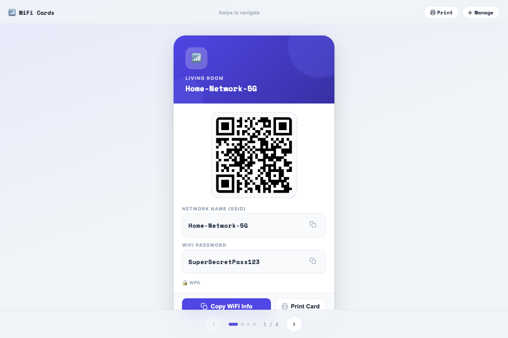
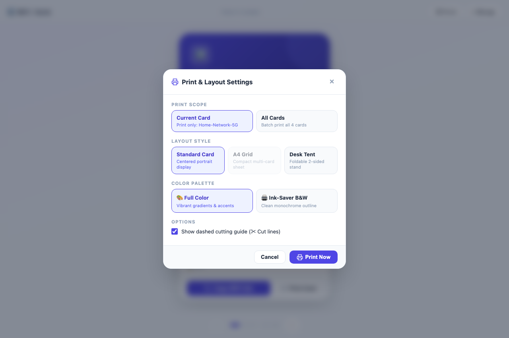
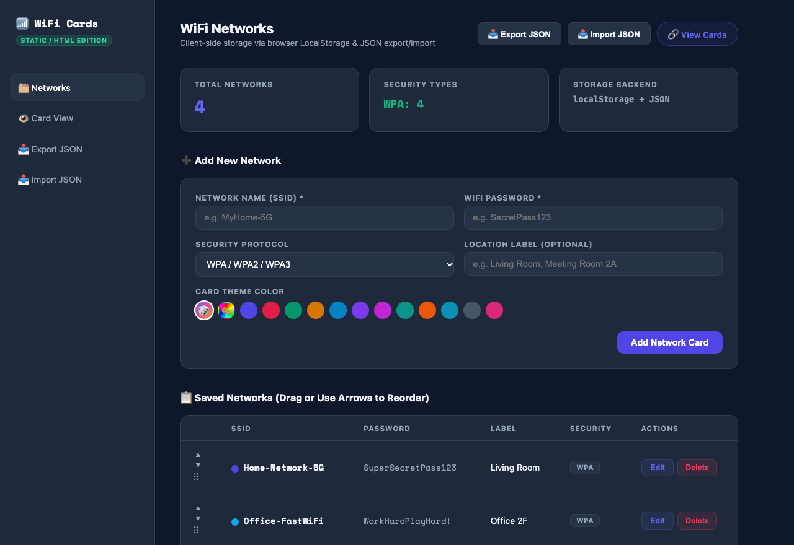

# 📶 WiFi Card — Printable WiFi Connection Cards & Desk Tents

> Generate beautiful, printable WiFi cards with instant QR code connection for your home, Airbnb, coffee shop, or office.

Supports standard single cards, 2×2 multi-card grids, and symmetrical foldable A-frame desk tents. Guests can simply point their phone camera or WeChat scanner at the QR code to join your Wi-Fi network instantly without typing passwords.

<p align="center">
  
</p>

---

## 📸 Screenshots & Previews

| 📱 WiFi Card View | 🖨️ Print Layout Settings | ⚙️ Admin Dashboard |
| :---: | :---: | :---: |
|  |  |  |

---

## ✨ Features

- **📱 Instant One-Tap Connection**: Generates standard Wi-Fi QR codes compatible with iOS, iPadOS, Android, and WeChat scanner.
- **🖨️ Print Layouts**:
  - **Single Standard Card**: Cleanly centered on A4 / Letter sheets.
  - **2×2 Grid**: Print up to 4 network cards efficiently on a single page.
  - **Foldable Desk Tent**: Symmetrical top-and-bottom cards with a center fold line—perfect for table stands, Airbnb welcome tables, reception desks, and cafe counters.
  - **Style Options**: Full Color or Ink-Saving Black & White / Eco mode.
  - **Cutting Guides**: Optional dashed scissor guidelines (`✂ Cut lines`).
- **🎨 Custom Colors**: Choose from 12 curated color palettes, pick any custom hex color, or roll random gradient themes.
- **🔒 Privacy First & 100% Offline Capable**: All QR codes are rendered client-side in the browser using JavaScript. No network credentials are ever sent to external third-party services.
- **📱 Responsive & Touch Friendly**: Smooth carousel swipe gesture support for mobile devices and keyboard arrow navigation.

---

## 📂 Two Available Editions

This repository includes two standalone editions ready to deploy:

```
forGithub/
├── html-version/         # 🌟 Pure static HTML/JS edition (GitHub Pages ready)
│   ├── index.html        # Public WiFi card viewer & print modal
│   ├── admin.html        # Client-side admin dashboard (LocalStorage + Export/Import)
│   └── data.json         # Sample demo network data
│
└── php-version/          # 🐘 Self-hosted PHP edition
    ├── index.html        # Public WiFi card viewer & print modal
    ├── admin.php         # Password-protected admin backend (server data.json)
    └── data.json         # Server-side network data file
```

---

### 1. Pure HTML Edition (`html-version/`)

**Ideal for**: GitHub Pages, Cloudflare Pages, Netlify, Vercel, or local offline use in any browser.

- **No server required**: Runs completely in the browser.
- **LocalStorage Persistence**: Add, edit, delete, and reorder networks directly in your browser.
- **JSON Backup & Sync**:
  - **Export JSON**: Download your networks as `data.json` at any time.
  - **Import JSON**: Upload your saved `data.json` on any device to restore your network cards instantly.
- **Easy Deployment**: Just push to a repository and enable **GitHub Pages** pointing to `html-version/`.

#### Quick Start (HTML Edition):
1. Open `html-version/index.html` in your browser to view your WiFi cards.
2. Open `html-version/admin.html` to add, edit, reorder, or customize your networks.
3. Use **Export JSON** to save your configuration, or **Import JSON** to transfer between devices.

---

### 2. PHP Edition (`php-version/`)

**Ideal for**: Self-hosted Apache/Nginx web servers, Docker containers, Synology NAS, or cPanel hosting.

- **Centralized Server Storage**: Reads and writes to `data.json` directly on your server.
- **Password-Protected Admin**: Secure `admin.php` dashboard with session authentication.
- **JSON Export & Import**: Built-in backup and restore tools inside the admin panel.

#### Quick Start (PHP Edition):
1. Upload the contents of `php-version/` to your web server (e.g. `/var/www/html/wifi`).
2. Ensure the web server has write permissions for `data.json`:
   ```bash
   chmod 666 data.json
   ```
3. Open `admin.php` in your code editor and change the default admin password:
   ```php
   define('ADMIN_PASSWORD', 'YourStrongPasswordHere');
   ```
4. Access `admin.php` in your browser, log in, and manage your WiFi networks.
5. Visitors can view and print cards via `index.html`.

---

## 📄 Data Structure (`data.json`)

Both editions use the same clean JSON format:

```json
[
  {
    "id": "1",
    "ssid": "Home-Network-5G",
    "password": "SuperSecretPass123",
    "type": "WPA",
    "label": "Living Room",
    "color": "#4f46e5"
  },
  {
    "id": "2",
    "ssid": "CoffeeShop-Guest",
    "password": "",
    "type": "nopass",
    "label": "Open Guest WiFi",
    "color": "#0ea5e9"
  }
]
```

### Supported Security Protocols:
- `WPA`: WPA / WPA2 / WPA3 (standard for home and business routers)
- `WEP`: Legacy WEP security
- `nopass`: Open network with no password

---

## 🖨️ Printing Instructions

1. Click the **Print Card** button in the top-right header or press `Ctrl + P` / `Cmd + P`.
2. Choose your preferred options in the modal:
   - **Print Scope**: Current card only, or All saved networks.
   - **Layout**:
     - *Standard Single Card* (centered on the page)
     - *2×2 Grid* (up to 4 cards on 1 sheet)
     - *Foldable Desk Tent* (dual-sided A-frame tent)
   - **Color Style**: Full Color or Black & White (Eco)
   - **Cut Guides**: Toggle dashed scissor lines
3. In the browser print dialog:
   - **Paper Size**: A4 or US Letter.
   - **Margins**: Default or None.
   - **Background Graphics**: **Must be enabled** (checked) to print colors and borders properly.

---

## 🔒 Security & Privacy Notice

- The sample files in this repository use generic placeholder passwords.
- Always change the default admin password in `admin.php` when deploying the PHP version to a public server.
- For maximum security on public static hosts, use the `html-version` and manage data locally via browser `localStorage` and `data.json` export/import.

---

## 📄 License

MIT License. Free to use for personal and commercial projects.
